# Corporate Service Request & Support Management Portal

## Table of Contents

- [Project Overview](#project-overview)
- [Problem Statement](#problem-statement)
- [Project Objectives](#project-objectives)
- [Key Features](#key-features)
- [Technology Stack](#technology-stack)
- [System Architecture](#system-architecture)
- [Project Structure](#project-structure)
- [Database Design](#database-design)
- [API Documentation](#api-documentation)
- [Authentication & Authorization](#authentication--authorization)
- [Request Workflow](#request-workflow)
- [Dashboard Overview](#dashboard-overview)
- [Application Screenshots](#application-screenshots)
- [Testing](#testing)
- [Installation & Setup](#installation--setup)
- [Environment Variables](#environment-variables)
- [Security Features](#security-features)
- [Limitations & Future Enhancements](#limitations--future-enhancements)
- [Conclusion](#conclusion)
- [Author](#author)

## Project Overview

The Corporate Service Request & Support Management Portal is a MERN stack web application designed to simplify the management of internal service requests within an organization.

The system allows employees to create and track service requests, support team members to manage and resolve requests, and administrators to monitor overall system activity through a centralized dashboard.

The application provides role-based access, request status tracking, request assignment, comments, resolution notes, and dashboard analytics to improve the efficiency of corporate support operations.

## Problem Statement

In many organizations, internal service requests are managed through emails, phone calls, or informal communication. This can make it difficult to track request status, assign responsibilities, monitor pending issues, and maintain a record of resolutions.

The Corporate Service Request & Support Management Portal addresses these challenges by providing a centralized platform where employees can submit service requests, support team members can manage and resolve requests, and administrators can monitor request activity.

This helps improve request tracking, task coordination, transparency, and the overall efficiency of internal support operations.

## Project Objectives

The main objectives of the project are:

- To provide a centralized platform for managing corporate service requests.
- To enable employees to create, view, and track their service requests.
- To allow support team members to assign, manage, and resolve requests.
- To implement role-based authentication and authorization for employees, support team members, and administrators.
- To maintain request status history and resolution details.
- To provide administrators with dashboard statistics and visual analytics.
- To improve the transparency and efficiency of internal support operations.

## Key Features

### 1. Role-Based Authentication

- Separate login options for Employees, Support Team members, and Administrators.
- Role-based access control to restrict access to authorized pages.
- Employee registration and login/logout functionality.

### 2. Employee Module

- Create new service requests.
- View and track submitted requests.
- View request details and status history.
- Update or cancel eligible requests.
- Add comments to service requests.

### 3. Support Team Module

- View and manage service requests.
- Search and filter requests.
- Assign requests to support team members.
- Update request status.
- Add resolution notes.
- Track request progress.

### 4. Admin Module

- View service request statistics.
- Monitor requests by status, category, and priority.
- View dashboard charts and summary information.

### 5. Request Management

- Generate unique request IDs.
- Manage request priorities and categories.
- Track status changes.
- Identify escalated and overdue requests.
- Simulate notifications for request assignments and status updates.

## Technology Stack

### Frontend

- React.js
- Vite
- Bootstrap
- React Router DOM
- Axios
- React Toastify
- Recharts

### Backend

- Node.js
- Express.js
- REST APIs

### Database

- MongoDB
- Mongoose

### Authentication & Security

- JSON Web Token (JWT)
- bcryptjs

### Development Tools

- Visual Studio Code
- Git and GitHub
- MongoDB Atlas
- Postman (keep this item only if you used Postman for API testing)

## System Architecture

The application follows a client-server architecture using the MERN stack.

- **Frontend:** The React.js application provides the user interface for Employees, Support Team members, and Administrators.
- **Backend:** The Node.js and Express.js server handles API requests, authentication, authorization, and service request operations.
- **Database:** MongoDB stores user accounts, service requests, comments, and related information.
- **Communication:** The frontend communicates with the backend through REST APIs using Axios.
- **Access Control:** JWT-based authentication and role-based authorization help protect restricted routes and operations.

### Architecture Flow

```text
User (Employee / Support / Admin)
              |
              v
       React.js Frontend
              |
              v
        Axios & REST APIs
              |
              v
  Node.js + Express.js Backend
              |
              v
       MongoDB Database
```

## Project Structure

The following is a representative structure. Check it against your actual folders and filenames before publishing.

```text
service-request-portal/
├── client/
│   ├── public/
│   ├── src/
│   │   ├── components/
│   │   ├── context/
│   │   ├── pages/
│   │   ├── services/
│   │   ├── App.jsx
│   │   ├── App.css
│   │   └── main.jsx
│   └── package.json
├── server/
│   ├── config/
│   ├── controllers/
│   ├── middleware/
│   ├── models/
│   ├── routes/
│   ├── utils/
│   ├── .env
│   ├── package.json
│   └── server.js
├── screenshots/
└── README.md
```

## Database Design

The application uses MongoDB as its database and Mongoose to define schemas and manage database operations.

### 1. User

Stores user account information.

- Name
- Email
- Hashed Password
- Role (Employee, Support, or Admin)
- Created At and Updated At

### 2. Service Request

Stores information about service requests.

- Unique Request ID
- Title and Description
- Category and Priority
- Request Status
- Created By
- Assigned To
- Resolution Notes
- Due Date
- Status History
- Escalation Status
- Created At and Updated At

### 3. Comment

Stores comments added to service requests.

- Request Reference
- User Reference
- Comment
- Created At and Updated At

### 4. Counter

Maintains a counter used to generate unique service request IDs.

These models help organize user accounts, service requests, request comments, and request ID generation.

## API Documentation

The backend provides REST APIs for authentication and service request management.

### Base URL

```text
http://localhost:5000/api
```

### Authentication APIs

| Method | Endpoint | Description |
|---|---|---|
| POST | `/auth/register` | Register a new employee |
| POST | `/auth/login` | Authenticate a user |

### Service Request APIs

| Method | Endpoint | Description |
|---|---|---|
| POST | `/requests` | Create a service request |
| GET | `/requests` | Retrieve service requests |
| GET | `/requests/:id` | Retrieve a specific request |
| PUT | `/requests/:id` | Update a service request |
| DELETE | `/requests/:id` | Delete or cancel a request, depending on the implementation |
| PATCH | `/requests/:id/status` | Update request status |
| PATCH | `/requests/:id/assign` | Assign a request to a support user |
| POST | `/requests/:id/comments` | Add a comment to a request |

### Authentication

Protected endpoints require a valid JSON Web Token (JWT) in the Authorization header.

Example:

```text
Authorization: Bearer <your_token>
```

The available operations depend on the user's role and the authorization rules implemented by the backend. Verify all endpoint paths and methods against the actual backend routes before publishing this documentation.

## Authentication & Authorization

The application implements authentication and role-based authorization to manage user access.

### Authentication

- Users can log in using their registered email address and password.
- Passwords are hashed using bcryptjs before being stored.
- JSON Web Tokens (JWT) are used to authenticate users.
- The authentication middleware verifies tokens for protected API routes.

### Role-Based Authorization

The application supports three user roles:

- **Employee:** Can access employee-specific features, including service request management.
- **Support:** Can access support features to manage and process service requests.
- **Admin:** Can access administrative features and dashboard analytics.

### Support and Admin Account Setup

- Employee accounts can be registered through the application's registration page.
- Support and Admin accounts must be created or assigned the appropriate roles directly in the database.
- During login, users must select the correct role and provide valid credentials.
- Access to role-specific dashboards and features is restricted according to the user's assigned role.

### Protected Routes

- React protected routes restrict access to pages based on user roles.
- Backend middleware protects authorized API operations.
- Users are redirected or denied access when they do not have the required role.

## Request Workflow

The application follows a structured workflow for managing service requests.

1. **Request Creation:** An employee logs in and submits a service request with its title, description, category, and priority.
2. **Request Assignment:** A support team member is assigned to handle the request.
3. **In Progress:** The support team works on the request and updates its status.
4. **Resolution:** The support team resolves the issue and adds resolution notes.
5. **Closure:** The request is marked as closed after the resolution process.

### Request Status Flow

```text
New → Assigned → In Progress → Resolved → Closed
```

The system maintains status history to help track changes made during the request lifecycle.

## Dashboard Overview

The application provides role-specific dashboards to help users perform their tasks efficiently.

### Employee Dashboard

- View submitted service requests.
- Track request statuses.
- Access request details.
- Create and manage eligible requests.

### Support Dashboard

- View and manage assigned service requests.
- Search and filter requests.
- Update request statuses.
- Manage request resolution.

### Admin Dashboard

- View overall service request statistics.
- Monitor requests by category, status, and priority.
- Analyze request information through dashboard charts.
- Track the overall status of support operations.

## Application Screenshots

The following screenshots demonstrate the main pages and features of the Service Request Portal.

### Role Selection Page

Allows users to select their role before logging in.

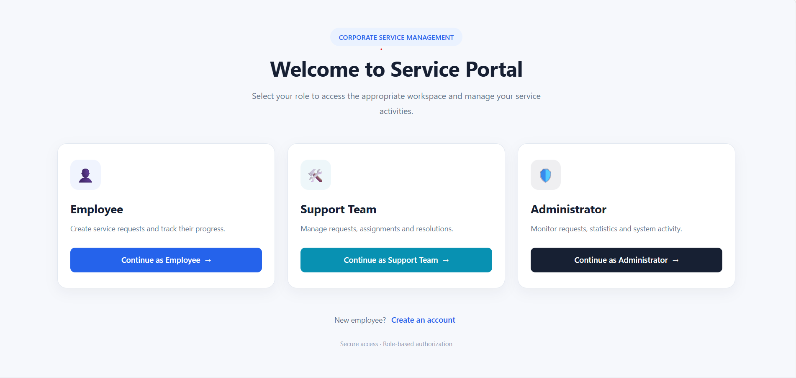

### Employee Login

Provides login access for employees.

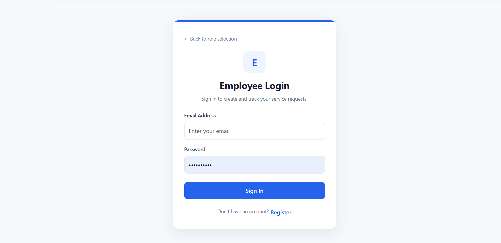

### Support Team Login

Provides login access for support team members.

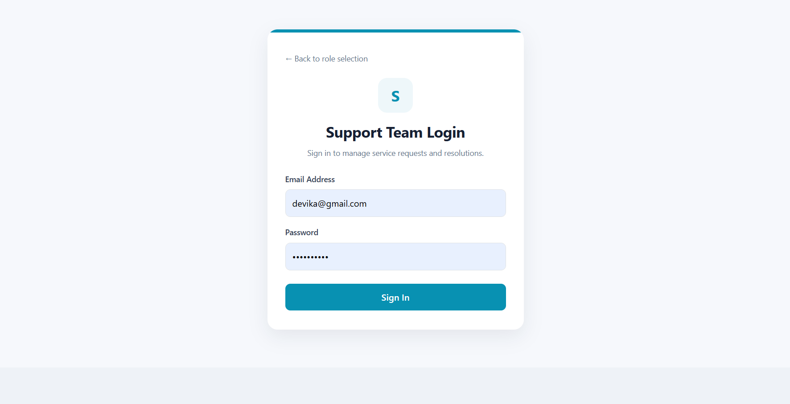

### Admin Login

Provides login access for administrators.

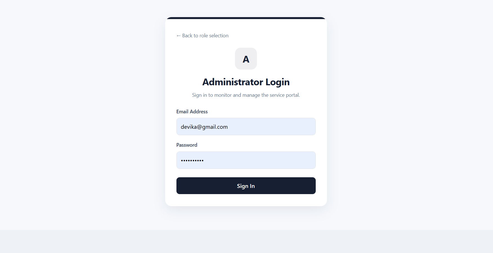

### Employee Dashboard

Displays employee service requests and their current status.

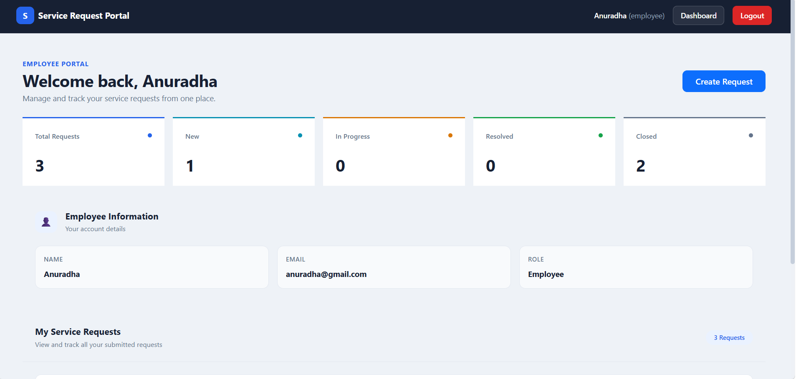

### Create Service Request

Allows employees to submit new service requests.

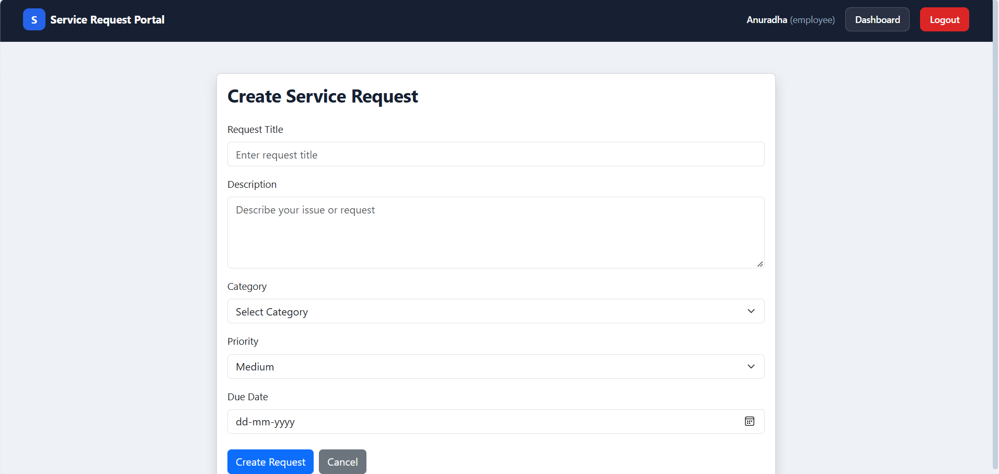

### Request Details

Displays the details and current status of a service request.

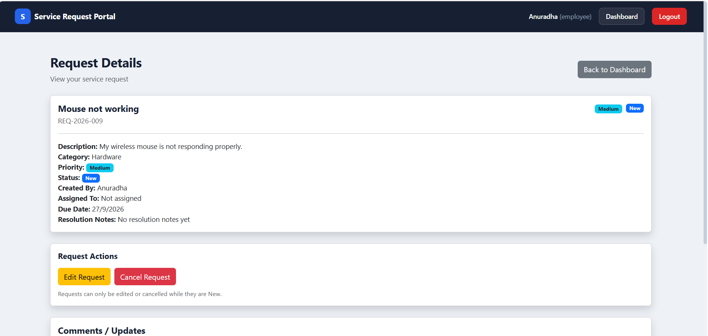

### Request Workflow

Displays service requests with their priorities, statuses, escalation levels, and assignment details.

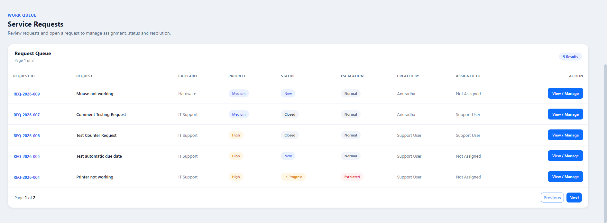

### Support Dashboard

Allows support team members to view and manage service requests.

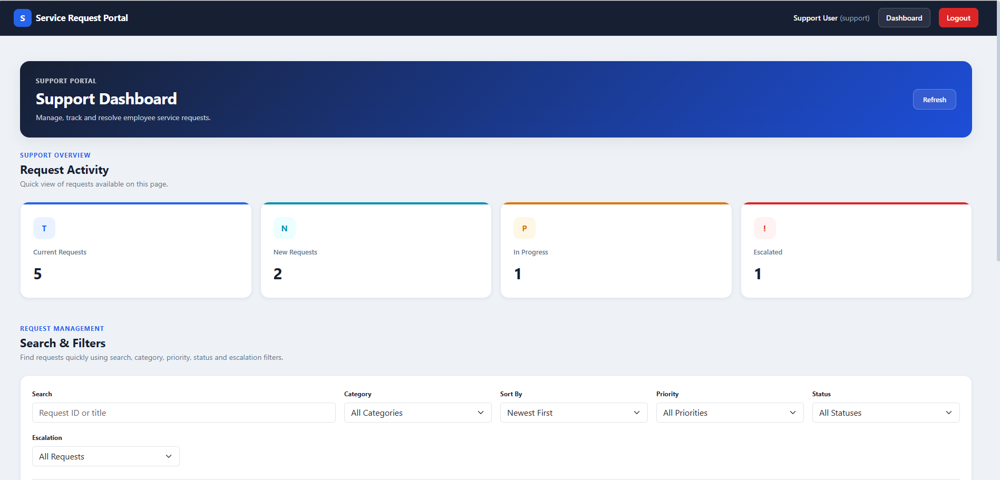

### Admin Dashboard

Displays service request statistics and analytics, including category-wise and status-wise charts.

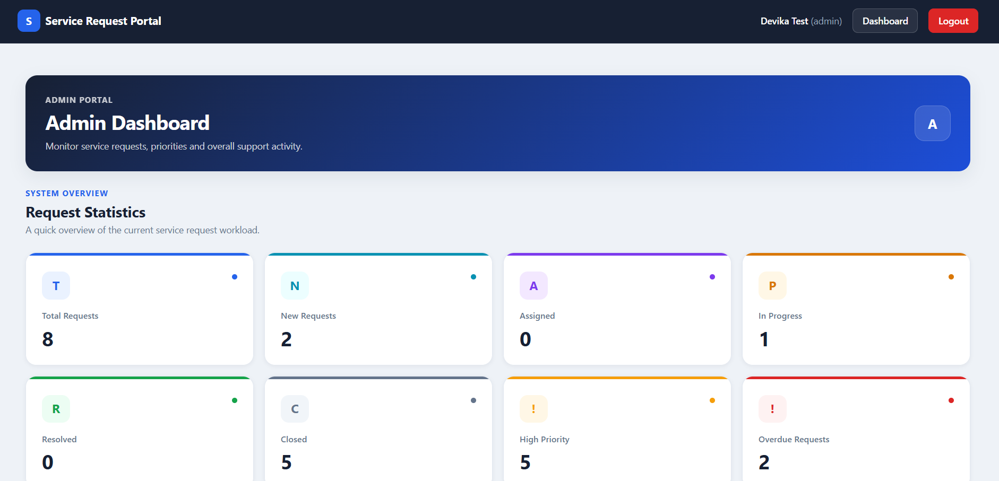

### Admin Dashboard Analytics

Displays additional dashboard analytics, including the request priority chart.

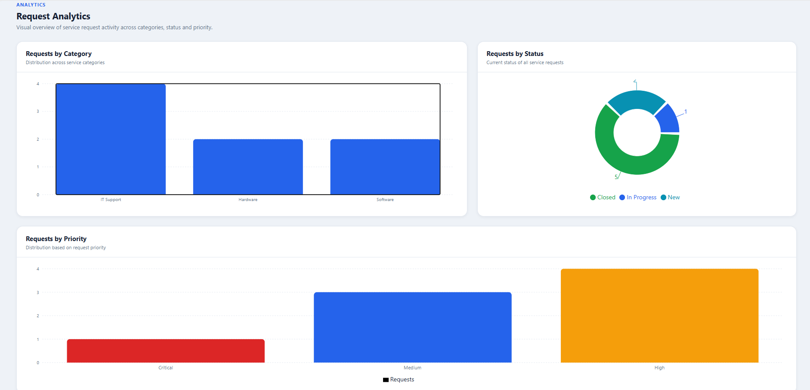


## Testing

The application was tested to verify its main functionalities.

### Authentication Testing

- Verified employee registration and login.
- Tested login for Employee, Support, and Admin roles.
- Verified role-based access to protected pages.
- Tested logout functionality.

### Service Request Testing

- Tested service request creation and viewing.
- Verified request assignment to support team members.
- Tested request status transitions.
- Verified request comments and resolution notes.
- Tested request cancellation.

### Dashboard Testing

- Verified employee request information.
- Tested support dashboard search and filtering.
- Checked admin dashboard statistics and charts.

### Backend Testing

- Verified API operations and database connectivity.
- Tested request status history and notification simulation.

## Installation & Setup

Follow these steps to set up and run the project locally.

### Prerequisites

Make sure the following software is installed:

- Node.js and npm
- MongoDB Atlas account or a MongoDB instance
- Visual Studio Code or another code editor
- Git (optional)

### 1. Clone the Repository

Replace `<your-repository-url>` with the URL of your GitHub repository.

```bash
git clone <your-repository-url>
cd service-request-portal
```

### 2. Install Backend Dependencies

Open a terminal and navigate to the server directory.

```bash
cd server
npm install
```

### 3. Configure Environment Variables

Create a `.env` file inside the `server` directory and configure the required environment variables.

```env
PORT=5000
MONGO_URI=your_mongodb_connection_string
JWT_SECRET=your_secret_key
```

Replace the placeholder values with your own configuration.

### 4. Start the Backend Server

From the `server` directory, run:

```bash
npm run dev
```

The backend server should start on port 5000 if the server configuration uses this port.

### 5. Install Frontend Dependencies

Open a new terminal at the project root and navigate to the client directory.

```bash
cd client
npm install
```

### 6. Start the Frontend Application

From the `client` directory, run:

```bash
npm run dev
```

Open the local URL displayed in the terminal to access the application.

## Environment Variables

The backend uses environment variables to manage configuration settings and sensitive information.

Create a `.env` file inside the `server` directory and configure the following variables:

| Variable | Description |
|---|---|
| `PORT` | Port number on which the backend server runs |
| `MONGO_URI` | MongoDB connection string |
| `JWT_SECRET` | Secret key used to sign and verify JSON Web Tokens |

### Example Configuration

```env
PORT=5000
MONGO_URI=your_mongodb_connection_string
JWT_SECRET=your_secret_key
```

**Important:** Replace the placeholder values with your actual configuration. Never commit your `.env` file or expose database credentials and JWT secrets in a public repository.

## Security Features

The application includes authentication and access control mechanisms to help protect user accounts and service request data.

- **Password Hashing:** Uses bcryptjs to hash passwords before storing them in the database.
- **JWT Authentication:** Uses JSON Web Tokens to authenticate users.
- **Role-Based Access Control:** Restricts access to features according to user roles.
- **Protected Frontend Routes:** Restricts access to role-specific pages based on the current user's role.
- **Backend Authorization:** Uses authentication and authorization middleware to protect API operations, where implemented.
- **Environment Variables:** Keeps sensitive configuration values outside the application source code.

These mechanisms help improve the security of user accounts and restrict access to authorized application features.

## Limitations & Future Enhancements

### Current Limitations

- Email notifications are simulated through server-side console logs rather than actual email delivery.
- The application requires an internet connection when using a cloud-hosted MongoDB Atlas database.
- The application currently focuses on internal service request management.

### Future Enhancements

- Integrate an email service to send real-time notifications.
- Add file attachments for service requests.
- Introduce real-time updates for request status changes.
- Improve reporting with downloadable reports and advanced analytics.
- Add more administrative tools for managing users and support teams.

## Conclusion

The Corporate Service Request & Support Management Portal provides a centralized solution for managing internal corporate service requests.

Built using the MERN stack, the application supports role-based access for Employees, Support Team members, and Administrators. It enables service request creation, assignment, status tracking, resolution management, and dashboard-based monitoring.

This project demonstrates the practical application of full-stack web development, REST API integration, database management, authentication, and role-based authorization.

The project can be further enhanced with additional features to improve automation, reporting, and the overall user experience.

## Author

**Devika Warekar**  
M.Sc. Computer Science Student

### Project Information

- **Project Name:** Corporate Service Request & Support Management Portal
- **Technology:** MERN Stack
- **Purpose:** Academic / Internship Project

### Connect with Me

- **GitHub:** [Devika-2004](https://github.com/Devika-2004)
- **LinkedIn:** [Devika Warekar](https://www.linkedin.com/in/devikawarekar/)
